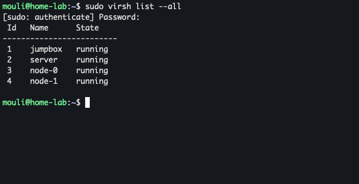

# kubernetes_cluster_hardway_setup

Documenting setup of kubernetes clusters from scratch following Kelsey Hightower’s kubernetes-the-hard-way.

Setting up virtual machines :

one jump server and control plane and 2 worker nodes as below 

