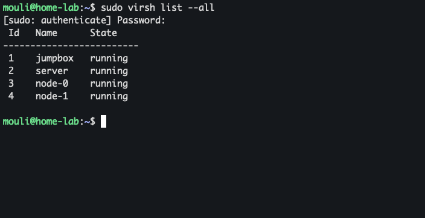

# kubernetes_cluster_hardway_setup

Documenting the setup of a Kubernetes cluster from scratch on KVM virtual machines, following Kelsey Hightower's [Kubernetes The Hard Way](https://github.com/kelseyhightower/kubernetes-the-hard-way), adapted for Ubuntu 24.04.



## Overview

All four machines run as KVM virtual machines on a single physical Ubuntu host. The VMs share the libvirt default NAT network (`192.168.122.0/24`).

| Name | Role | IP | RAM | vCPU |
|---|---|---|---|---|
| jumpbox | Administration host | 192.168.122.10 | 512 MB | 1 |
| server | Control plane | 192.168.122.11 | 2 GB | 1 |
| node-0 | Worker | 192.168.122.12 | 2 GB | 1 |
| node-1 | Worker | 192.168.122.13 | 2 GB | 1 |

## Prerequisites

**Host:**
- Ubuntu 24.04 with hardware virtualization enabled (AMD-V or Intel VT-x)
- At least 16 GB RAM (the four VMs use about 6.5 GB)
- About 80 GB of free disk space

**Packages:**

```bash
sudo apt update
sudo apt install -y qemu-system-x86 libvirt-daemon-system libvirt-clients virtinst cloud-image-utils
sudo usermod -aG libvirt,kvm $USER
```

Log out and back in so the group change applies.

**SSH key:**

```bash
[ -f ~/.ssh/id_ed25519 ] || ssh-keygen -t ed25519 -N '' -f ~/.ssh/id_ed25519
```

## Stages

| Stage | Notes | Status |
|---|---|---|
| [01. VM setup](docs/01-vm-setup.md) | KVM install, cloud image, four VMs, SSH access | completed |
| [02. Jumpbox setup](docs/02-jumpbox.md) | Install `kubectl` | completed |
| [03. Certificates](docs/03-certificates.md) | CA and component certificates | completed |
| [04. Kubeconfigs](docs/04-kubeconfigs.md) | Kubelet, kube-proxy, controller, scheduler, admin | completed |
| [05. etcd](docs/05-etcd.md) | Bootstrap etcd on `server` | completed |
| [06. Control plane](docs/06-control-plane.md) | API server, controller manager, scheduler | Completed |
| [07. Worker_nodes](docs/07-worker-nodes.md) | containerd, kubelet, kube-proxy on `node-0` and `node-1` | completed |
| [08. Configuring-kubectl-RemoteAccess](/docs/08-Configuring-kubectl-RemoteAccess.md) | Configuring kubectl for Remote Access | completed |
| 09. Networking | Pod routes and CNI | Not started |
| 10. Smoke test | Deployment, port-forward, NodePort service | Not started |

## Differences from the tutorial

- **OS:** Ubuntu 24.04 instead of Debian 12.
- **Login user:** The tutorial logs in as `root`. Ubuntu cloud images disable root SSH, so this setup uses the `ubuntu` user with `sudo`. Remote commands that need root are prefixed with `sudo`.
- **Networking:** VMs use the libvirt NAT network at `192.168.122.0/24`, and names are resolved through `/etc/hosts`.
- **Package names:** `qemu-kvm` is a virtual package on Ubuntu 24.04, so install `qemu-system-x86`.

## Known issues

- **`qemu-kvm` package conflict:** Install `qemu-system-x86` instead.
- **Script run with `sudo`:** `$HOME` changes to `/root`, so the script reads the SSH key from `$SUDO_USER`'s home directory.
- **Script run with `sh`:** The script uses bash arrays and must run with `bash`, not `sh`.
- **`ssh-copy-id` fails:** Cloud images disable password login, so `ssh-copy-id` can't install keys. Copy the public key into each node's `~/.ssh/authorized_keys` from a machine that already has access.
- **Jumpbox cannot reach nodes by name:** Name resolution works only after `/etc/hosts` entries are added on the jumpbox itself. Adding them on the host is not enough.

## Repository layout

```
kubernetes_cluster_hardway_setup/
├── README.md
├── images/
│   └── running_vms.png
├── scripts/
│   └── create-vms.sh
└── docs/
    └── 01-vm-setup.md
```

## Security note

The lab uses SSH keys without passphrases, and the VMs sit on a local NAT network. This setup is for learning, not production.
