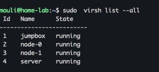
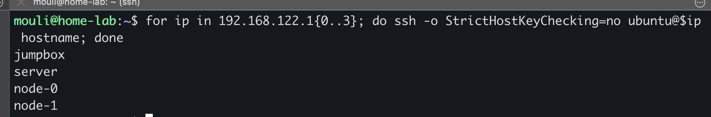
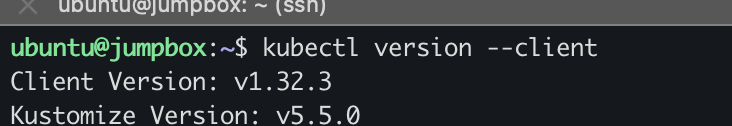

# 01. VM setup

This stage creates the four KVM virtual machines on the physical host and confirms SSH access to each one.

## Host

- CPU: AMD Ryzen 9 7900 (12 cores, 24 threads)
- RAM: 60 GB
- Disk: about 779 GB free on `/`
- Hardware virtualization: enabled (`egrep -c '(vmx|svm)' /proc/cpuinfo` returns 24)

## 1. Install the virtualization stack

`qemu-kvm` is a virtual package on Ubuntu 24.04. Apt asks you to choose a provider, so install `qemu-system-x86` directly:

```bash
sudo apt update
sudo apt install -y qemu-system-x86 libvirt-daemon-system libvirt-clients bridge-utils virtinst cloud-image-utils

```

## 2. Download the Ubuntu cloud image and create an SSH key

```bash
sudo mkdir -p /var/lib/libvirt/images
sudo wget -O /var/lib/libvirt/images/noble-base.img \
  https://cloud-images.ubuntu.com/noble/current/noble-server-cloudimg-amd64.img
[ -f ~/.ssh/id_ed25519 ] || ssh-keygen -t ed25519 -N '' -f ~/.ssh/id_ed25519
```

Confirm both files exist:

```bash
ls -lh /var/lib/libvirt/images/noble-base.img
ls ~/.ssh/id_ed25519.pub
```

## 3. Create the VMs

`scripts/create-vms.sh` creates each VM with a static IP on the default network, a fixed MAC address, and the SSH public key from cloud-init.

The VM list in the script:

```bash
VMS=(
  "jumpbox 192.168.122.10 52:54:00:00:00:0a 1 512"
  "server  192.168.122.11 52:54:00:00:00:0b 1 2048"
  "node-0  192.168.122.12 52:54:00:00:00:0c 1 2048"
  "node-1  192.168.122.13 52:54:00:00:00:0d 1 2048"
)
```

Run it with `bash`, not `sh`, and with `sudo`:

```bash
sudo bash scripts/create-vms.sh
sudo virsh list --all
```


Output:




## 4. Verify SSH from the physical host

```bash
for ip in 192.168.122.1{0..3}; do ssh -o StrictHostKeyChecking=no ubuntu@$ip hostname; done
```

Output:




## Issues encountered

**`qemu-kvm` cannot be installed directly.** Apt reports it as a virtual package. Install `qemu-system-x86` instead.

**The script failed with `Syntax error: "(" unexpected`.** The script was run with `sh` (dash) instead of bash. Run it with `sudo bash`.

**The SSH key path was wrong under `sudo`.** `sudo` changes `$HOME` to `/root`. The script reads the key from `/home/${SUDO_USER}/.ssh/id_ed25519.pub`.

**The jumpbox could not reach the nodes.** Running the copy loop from the jumpbox failed with `Permission denied (publickey)`. Two things were wrong:

- `ssh-copy-id` cannot install keys, because cloud images disable password login.
- The physical host's key was the only one installed on the nodes, so the jumpbox's own key was never authorized.

**Fix:** Copy the jumpbox's public key into each node's `~/.ssh/authorized_keys` from the physical host, which already has access:

```bash
# on the jumpbox
cat ~/.ssh/id_ed25519.pub

# on the physical host, replacing PASTE_LINE_HERE with that line
cat > /tmp/jumpbox.pub <<'EOF'
PASTE_LINE_HERE
EOF
for ip in 192.168.122.11 192.168.122.12 192.168.122.13; do
  scp /tmp/jumpbox.pub ubuntu@$ip:/tmp/jumpbox.pub
  ssh ubuntu@$ip 'cat /tmp/jumpbox.pub >> ~/.ssh/authorized_keys && rm /tmp/jumpbox.pub'
done
```

Check that each node lists both keys:

```bash
for ip in 192.168.122.11 192.168.122.12 192.168.122.13; do
  echo "== $ip"; ssh ubuntu@$ip 'cat ~/.ssh/authorized_keys'
done
```

**The jumpbox could not resolve node names.** `/etc/hosts` entries were added on the physical host only. Add them on the jumpbox as well:

```bash
sudo tee -a /etc/hosts <<EOF
192.168.122.10 jumpbox
192.168.122.11 server server.kubernetes.local
192.168.122.12 node-0 node-0.kubernetes.local
192.168.122.13 node-1 node-1.kubernetes.local
EOF
```

**Result:** The jumpbox reaches `server`, `node-0`, and `node-1` by name over SSH as the `ubuntu` user.

## Verified

- [x] Four VMs running under libvirt
- [x] SSH from the physical host to all four VMs
- [x] SSH from the jumpbox to the three nodes by name


Once the keys copied to server and other nodes , it's time to download the binaries and install the kubectl once it is done kubectl 
client can be verified as below:

```bash
kubectl version --client
```

Output: 

