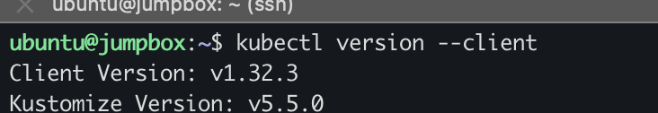

# 02. Jumpbox setup

This stage prepares the jumpbox, the administration host used for every remaining command in the tutorial. It follows the tutorial's "Set Up The Jumpbox" page, with the changes listed below.

## Differences from the tutorial

- **User:** The tutorial logs in as `root`. This setup uses the `ubuntu` user and prefixes root-only commands with `sudo`.
- **Working directory:** `/home/ubuntu/kubernetes-the-hard-way` instead of `/root/kubernetes-the-hard-way`.
- **SSH access:** Keys were set up in stage 01. The jumpbox's public key is in each node's `authorized_keys`.

## 1. Install command-line utilities

```bash
sudo apt-get update
sudo apt-get -y install wget curl vim openssl git
```

## 2. Clone the tutorial repository

```bash
git clone --depth 1 https://github.com/kelseyhightower/kubernetes-the-hard-way.git
cd kubernetes-the-hard-way
pwd
```

Expected output: `/home/ubuntu/kubernetes-the-hard-way`

## 3. Download the binaries

```bash
ARCH=$(dpkg --print-architecture)
cat downloads-${ARCH}.txt
wget -q --show-progress --https-only --timestamping \
  -P downloads -i downloads-${ARCH}.txt
```

## 4. Extract and organize the binaries

Run the extraction block from the tutorial. Its version numbers must match the files in `downloads/`.

Expected result:

```bash
ls downloads/*/
```

lists `client`, `cni-plugins`, `controller`, and `worker`, with the binaries inside each.

## 5. Install kubectl

```bash
sudo cp downloads/client/kubectl /usr/local/bin/
kubectl version --client
```


## Verified

- [x] Utilities installed
- [x] Repository cloned to `/home/ubuntu/kubernetes-the-hard-way`
- [x] Binaries downloaded and extracted into `downloads/client`, `cni-plugins`, `controller`, and `worker`
- [x] `kubectl` v1.32.3 installed on the jumpbox
