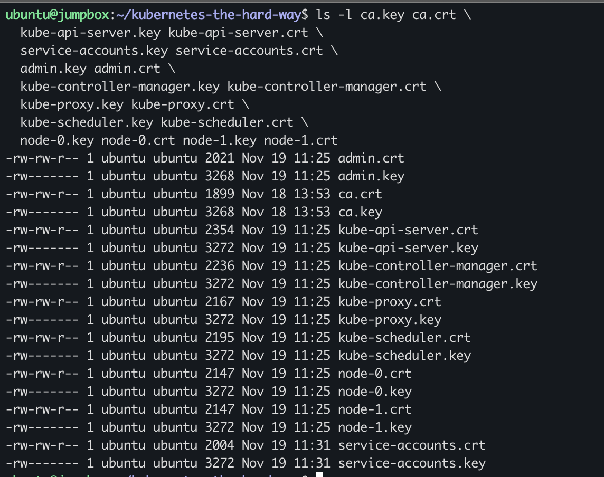

# 03. Certificates

This stage creates the certificate authority and the client and server certificates that every Kubernetes component uses for TLS. It follows the tutorial's CA and certificate pages, with the changes listed below.

## Differences from the tutorial

- **Working directory:** Commands run from `~/kubernetes-the-hard-way` on the jumpbox.
- **Copy target:** Files are `scp`'d to `ubuntu@<host>:~/` and moved into place with `sudo`, because root SSH is disabled on the cloud images.
- **API server address:** The tutorial uses a cloud load balancer address for `KUBERNETES_PUBLIC_ADDRESS`. This lab uses `server.kubernetes.local`, which is already in the API server certificate's SANs.

## 1. Generate the CA

```bash
openssl genrsa -out ca.key 4096
openssl req -x509 -new -sha512 -noenc \
  -key ca.key -days 3653 \
  -config ca.conf \
  -out ca.crt
```

## 2. Generate component certificates

Generated with the tutorial's `openssl` commands for: `admin`, `kube-api-server`, `service-accounts`, `kube-controller-manager`, `kube-proxy`, `kube-scheduler`, `node-0`, and `node-1`.

Verify all 18 files exist:

```bash
ls -l ca.key ca.crt \
  kube-api-server.key kube-api-server.crt \
  service-accounts.key service-accounts.crt \
  admin.key admin.crt \
  kube-controller-manager.key kube-controller-manager.crt \
  kube-proxy.key kube-proxy.crt \
  kube-scheduler.key kube-scheduler.crt \
  node-0.key node-0.crt node-1.key node-1.crt
```

Keys are mode `600`, and certificates are mode `644`.

## 3. Verify the API server certificate

```bash
openssl x509 -in kube-api-server.crt -noout -text | grep -A1 "Subject Alternative Name"
```

The SANs include `10.32.0.1`, `server.kubernetes.local`, and `api-server.kubernetes.local`.

```bash
openssl x509 -in ca.crt -noout -subject
openssl x509 -in kube-api-server.crt -noout -issuer
```

Both print `CN = CA`, so the API server certificate was issued by this CA.

## 4. Distribute certificates

Copy the node certificates to each worker:

```bash
for host in node-0 node-1; do
  ssh ubuntu@${host} "sudo mkdir -p /var/lib/kubelet/"
  scp ca.crt ubuntu@${host}:~/ca.crt
  scp ${host}.crt ubuntu@${host}:~/kubelet.crt
  scp ${host}.key ubuntu@${host}:~/kubelet.key
  ssh ubuntu@${host} "sudo mv ~/ca.crt ~/kubelet.crt ~/kubelet.key /var/lib/kubelet/"
done
```

Copy the control plane certificates to `server`:

```bash
scp \
  ca.key ca.crt \
  kube-api-server.key kube-api-server.crt \
  service-accounts.key service-accounts.crt \
  ubuntu@server:~/
```

Their final location, `/var/lib/kubernetes/`, is set up in the control plane stage.

## Verified

- [x] CA created (`ca.key`, `ca.crt`)
- [x] 16 component certificates and keys created
- [x] All 18 files present with correct permissions
- [x] API server SANs include `server.kubernetes.local`
- [x] API server certificate issued by `CN = CA`
- [x] Node certificates copied to `node-0` and `node-1`
- [x] Control plane certificates copied to `server`
