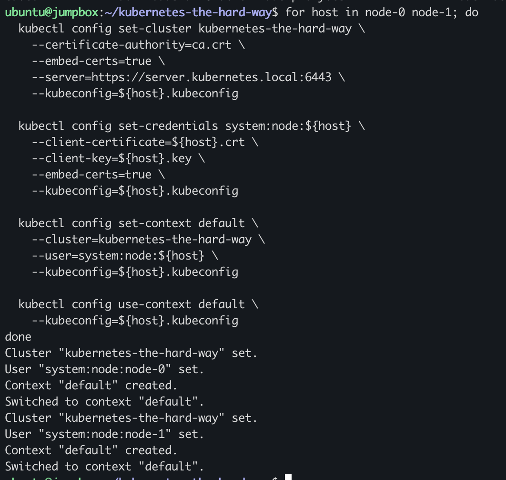
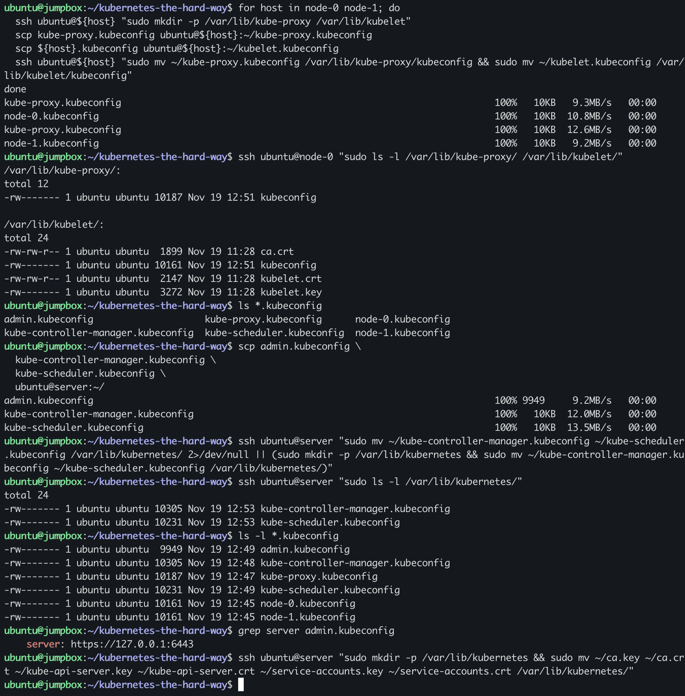

# 04. Kubeconfigs

This stage generates the kubeconfig files that each Kubernetes component uses to authenticate to the API server. It follows the tutorial's "Generating Kubernetes Configuration Files for Authentication" page, with the changes listed below.

## Differences from the tutorial

- **Where files are generated:** All kubeconfigs are created on the jumpbox, in `~/kubernetes-the-hard-way`.
- **API server address:** `KUBERNETES_PUBLIC_ADDRESS` is set to `server.kubernetes.local` instead of the tutorial's cloud public address. This name is already in the API server certificate's SANs.
- **Copy method:** Root SSH is disabled on the cloud images, so files are copied to the `ubuntu` user's home directory with `scp` and moved into place with `sudo`.

## 1. Set the API server address

Set this in the same shell where you generate the kubeconfigs:

```bash
KUBERNETES_PUBLIC_ADDRESS=server.kubernetes.local
```

## 2. Generate the kubeconfigs

Generated on the jumpbox for: `admin`, `kube-proxy`, `kube-controller-manager`, `kube-scheduler`, `node-0`, and `node-1`.

Check the output:

```bash
ls -l *.kubeconfig
grep server admin.kubeconfig
```

Expected: six `.kubeconfig` files, and the `server` line shows `https://server.kubernetes.local:6443`.

## 3. Distribute the kubeconfigs

Worker nodes receive their kubelet and kube-proxy configs:

```bash
for host in node-0 node-1; do
  ssh ubuntu@${host} "sudo mkdir -p /var/lib/kube-proxy /var/lib/kubelet"
  scp kube-proxy.kubeconfig ubuntu@${host}:~/kube-proxy.kubeconfig
  scp ${host}.kubeconfig ubuntu@${host}:~/kubelet.kubeconfig
  ssh ubuntu@${host} "sudo mv ~/kube-proxy.kubeconfig /var/lib/kube-proxy/kubeconfig && sudo mv ~/kubelet.kubeconfig /var/lib/kubelet/kubeconfig"
done
```



Check one node:

```bash
ssh ubuntu@node-0 "sudo ls -l /var/lib/kube-proxy/ /var/lib/kubelet/"
```

The control plane receives the controller manager and scheduler configs:

```bash
scp kube-controller-manager.kubeconfig kube-scheduler.kubeconfig ubuntu@server:~/
ssh ubuntu@server "sudo mkdir -p /var/lib/kubernetes && sudo mv ~/kube-controller-manager.kubeconfig ~/kube-scheduler.kubeconfig /var/lib/kubernetes/"
```

`admin.kubeconfig` stays on the jumpbox for `kubectl`.

## 4. Move control plane certificates

The certificates copied in stage 03 are moved into the same directory:

```bash
ssh ubuntu@server "sudo mv ~/ca.key ~/ca.crt ~/kube-api-server.key ~/kube-api-server.crt ~/service-accounts.key ~/service-accounts.crt /var/lib/kubernetes/"
ssh ubuntu@server "sudo ls -l /var/lib/kubernetes/"
```



Expected: eight files in `/var/lib/kubernetes/`, which are the two kubeconfigs and six certificate and key files.

## Issues encountered

**`scp` into `/var/lib` failed with `Permission denied`.** Copying directly to system directories needs root, and `scp` can't use `sudo`. Copy to the home directory first, then move with `sudo mv`.

**`sudo` in front of a `while` loop caused a syntax error.** `sudo` can't run shell keywords, so put `sudo` on the individual commands instead.

**The kubeconfig copies ran as `root@` at first.** Ubuntu cloud images disable root SSH, so every `root@` in the tutorial becomes `ubuntu@`.

## Verified

- [x] Six kubeconfigs generated on the jumpbox
- [x] `admin.kubeconfig` server address is `https://server.kubernetes.local:6443`
- [x] `kube-proxy.kubeconfig` and kubelet kubeconfig in place on `node-0` and `node-1`
- [x] `kube-controller-manager.kubeconfig` and `kube-scheduler.kubeconfig` in `/var/lib/kubernetes/` on `server`
- [x] Control plane certificates and keys in `/var/lib/kubernetes/` on `server`
