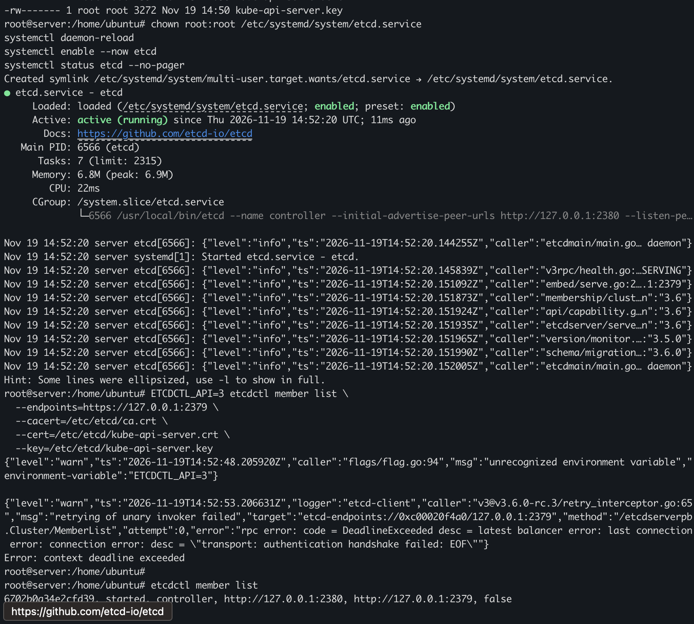

 05. etcd

This stage installs and starts etcd on `server`. etcd stores all Kubernetes cluster state, so it must run before the control plane. It follows the tutorial's "Bootstrapping the etcd Cluster" page, with the changes listed below.

## Differences from the tutorial

- **Login user:** Commands run as `ubuntu`, then `sudo -i` for the root steps on `server`.
- **Node name and addresses:** The tutorial's etcd unit uses the name `controller` and the `127.0.0.1` addresses. This lab uses the name `server` and the address `192.168.122.11`, because the control plane runs on `server` and must be reachable from the workers.
- **Unit file:** The tutorial's unit file as written here did not work. See "Issues encountered" below.

## 1. Copy the binaries and unit file

Run from `~/kubernetes-the-hard-way` on the jumpbox:

```bash
scp downloads/controller/etcd downloads/client/etcdctl units/etcd.service ubuntu@server:~/
```

On `server`, move them into place as root:

```bash
sudo mv ~/etcd ~/etcdctl /usr/local/bin/
sudo chown root:root /usr/local/bin/etcd /usr/local/bin/etcdctl
sudo mv ~/etcd.service /etc/systemd/system/
```

## 2. Create directories and copy certificates

On `server`:

```bash
sudo mkdir -p /etc/etcd /var/lib/etcd
sudo chmod 700 /var/lib/etcd
sudo cp /var/lib/kubernetes/ca.crt /var/lib/kubernetes/kube-api-server.crt /var/lib/kubernetes/kube-api-server.key /etc/etcd/
```

## 3. Write the etcd unit file

The unit file in `units/etcd.service` is replaced with the following on `server`. The key changes are HTTPS URLs, the `server` name, and the `192.168.122.11` address:

```ini
[Unit]
Description=etcd
Documentation=https://github.com/etcd-io/etcd

[Service]
Type=notify
ExecStart=/usr/local/bin/etcd \
  --name server \
  --cert-file=/etc/etcd/kube-api-server.crt \
  --key-file=/etc/etcd/kube-api-server.key \
  --peer-cert-file=/etc/etcd/kube-api-server.crt \
  --peer-key-file=/etc/etcd/kube-api-server.key \
  --trusted-ca-file=/etc/etcd/ca.crt \
  --peer-trusted-ca-file=/etc/etcd/ca.crt \
  --client-cert-auth \
  --peer-client-cert-auth \
  --initial-advertise-peer-urls https://192.168.122.11:2380 \
  --listen-peer-urls https://192.168.122.11:2380 \
  --listen-client-urls https://192.168.122.11:2379,https://127.0.0.1:2379 \
  --advertise-client-urls https://192.168.122.11:2379 \
  --initial-cluster-token etcd-cluster-0 \
  --initial-cluster server=https://192.168.122.11:2380 \
  --initial-cluster-state new \
  --data-dir=/var/lib/etcd
Restart=on-failure
RestartSec=5

[Install]
WantedBy=multi-user.target
```

## 4. Start etcd

```bash
sudo chown root:root /etc/systemd/system/etcd.service
sudo systemctl daemon-reload
sudo systemctl enable --now etcd
sudo systemctl status etcd --no-pager
```

Expected: `active (running)`.

## 5. Verify

```bash
sudo etcdctl member list \
  --endpoints=https://127.0.0.1:2379 \
  --cacert=/etc/etcd/ca.crt \
  --cert=/etc/etcd/kube-api-server.crt \
  --key=/etc/etcd/kube-api-server.key

sudo etcdctl endpoint health \
  --endpoints=https://127.0.0.1:2379 \
  --cacert=/etc/etcd/ca.crt \
  --cert=/etc/etcd/kube-api-server.crt \
  --key=/etc/etcd/kube-api-server.key
```

Expected: one member named `server` with status `started`, and the endpoint reports `is healthy`.

## Issues encountered

**etcd started but `etcdctl` failed with `authentication handshake failed: EOF`.** The tutorial's unit file, as written, served plain HTTP on `127.0.0.1` with the name `controller`. The TLS client flags then had nothing to connect to. Replacing the unit file with the HTTPS version above fixed it.

**The data directory kept the old member name.** etcd refuses to start with a different name over data created under the old one. Stop the service and clear `/var/lib/etcd/*` before restarting with a new name.

**`ETCDCTL_API=3` was flagged as an unrecognized variable.** etcd 3.6 uses the v3 API by default, so the variable isn't needed.



## Verified

- [x] `etcd` and `etcdctl` in `/usr/local/bin/`, owned by root
- [x] Unit file loaded and enabled on `server`
- [x] Certificates in `/etc/etcd/`
- [x] Single member `server` with status `started`
- [x] Endpoint healthy over TLS
