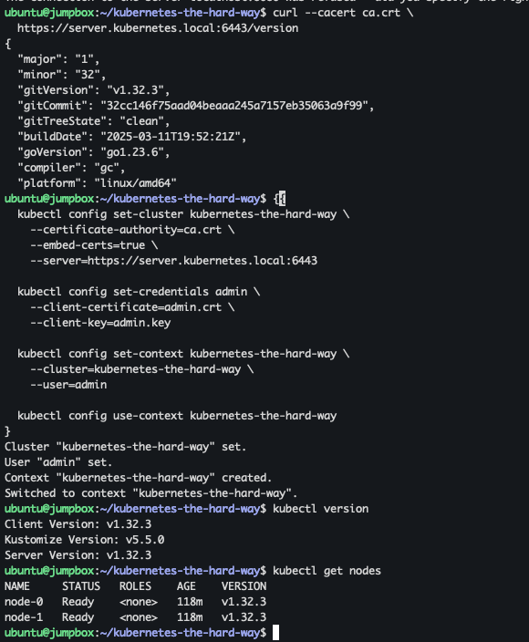

# 08. Configuring kubectl for remote access

This stage generates a kubeconfig for the `admin` user, so `kubectl` on the jumpbox can reach the API server. It follows the tutorial's "Configuring kubectl for Remote Access" page, with the changes listed below.

## Differences from the tutorial

- **Address:** The tutorial's examples use `server.kubernetes.local` already, so the server address is unchanged. The name resolves through `/etc/hosts` on the jumpbox, and that entry must survive reboots (see stage 02).
- **Architecture in the sample output:** The tutorial's example shows `linux/arm64`. This host is `linux/amd64`, so the `platform` field in your output will read `linux/amd64`.
- **Kubeconfig location:** The tutorial writes `~/.kube/config` and uses relative certificate names. The steps below do the same, so the kubeconfig records absolute paths that depend on the repo location.

## Verification

### 1. Check the API server with the CA

Run from `~/kubernetes-the-hard-way` on the jumpbox:

```bash
curl --cacert ca.crt https://server.kubernetes.local:6443/version
```

Expected: JSON with `"gitVersion": "v1.32.3"` and `"platform": "linux/amd64"`.

### 2. Generate the admin kubeconfig

```bash
{
  kubectl config set-cluster kubernetes-the-hard-way \
    --certificate-authority=ca.crt \
    --embed-certs=true \
    --server=https://server.kubernetes.local:6443

  kubectl config set-credentials admin \
    --client-certificate=admin.crt \
    --client-key=admin.key

  kubectl config set-context kubernetes-the-hard-way \
    --cluster=kubernetes-the-hard-way \
    --user=admin

  kubectl config use-context kubernetes-the-hard-way
}
```

Expected output:

```
Cluster "kubernetes-the-hard-way" set.
User "admin" set.
Context "kubernetes-the-hard-way" created.
Switched to context "kubernetes-the-hard-way".
```

This writes `~/.kube/config`, so `kubectl` works without `--kubeconfig`.

### 3. Check the client and server versions

```bash
kubectl version
```

Expected:

```
Client Version: v1.32.3
Kustomize Version: v5.5.0
Server Version: v1.32.3
```

### 4. List the nodes

```bash
kubectl get nodes
```

Expected: `node-0` and `node-1`, both `Ready`, running `v1.32.3`.




## Notes

- The CA is embedded in the kubeconfig. The client certificate and key are stored as paths, so the kubeconfig depends on the repo staying at `/home/ubuntu/kubernetes-the-hard-way`. To remove that dependency, re-run the `set-credentials` command with `--embed-certs=true`. This puts the admin private key inside `~/.kube/config`, so keep that file out of the repo.
- `~/.kube/config` holds credentials. Don't commit it or share it.

## Issues encountered

**`kubectl` on the jumpbox was refused at `127.0.0.1:6443`.** The `admin.kubeconfig` file generated in stage 04 pointed at the loopback address, because `KUBERNETES_PUBLIC_ADDRESS` wasn't set when it was created. The fix is to set the server address to `https://server.kubernetes.local:6443`, as in the step above.

**`kubectl` on `server` couldn't resolve `server.kubernetes.local`.** The VM had no entry for its own name, and cloud-init rewrote `/etc/hosts` on boot. Add the entry and disable cloud-init's hosts management, as in stage 06.

## Verified

- [x] `https://server.kubernetes.local:6443/version` returns `v1.32.3` with the CA
- [x] `kubectl version` shows matching client and server `v1.32.3`
- [x] `kubectl get nodes` lists `node-0` and `node-1` as `Ready`
