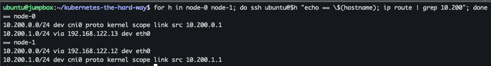

# 09. Pod networking

This stage connects pods on different workers. In the tutorial, the routes between pod subnets come from the cloud provider's route table. This lab has no route table, so static routes on each worker do the same job. The tutorial's pod networking steps are in the worker stage, and this page records the lab's version of them and how it was verified.

## Differences from the tutorial

- **Routing:** The tutorial adds pod routes through the cloud route table. This lab adds one static route per worker with `ip route add`, using the other worker's VM address as the next hop.
- **Persistence:** The routes are not persistent. They must be re-added after a worker reboots.
- **Netplan:** An earlier attempt used a Netplan file to make the routes persistent. It was removed, because the tutorial doesn't use Netplan for pod routes and the file was not needed for the test.

## Addressing

| Node | VM address | Pod subnet | CNI bridge address |
|---|---|---|---|
| node-0 | 192.168.122.12 | 10.200.0.0/24 | 10.200.0.1 |
| node-1 | 192.168.122.13 | 10.200.1.0/24 | 10.200.1.1 |

The pod subnets come from `machines.txt`, which the stage 07 render step uses to write each worker's `10-bridge.conf`.

## 1. Set the variables

Run from `~/kubernetes-the-hard-way` on the jumpbox:

```bash
SERVER_IP=$(grep server machines.txt | cut -d " " -f 1)
NODE_0_IP=$(grep node-0 machines.txt | cut -d " " -f 1)
NODE_0_SUBNET=$(grep node-0 machines.txt | cut -d " " -f 4)
NODE_1_IP=$(grep node-1 machines.txt | cut -d " " -f 1)
NODE_1_SUBNET=$(grep node-1 machines.txt | cut -d " " -f 4)
echo "SERVER=$SERVER_IP NODE_0=$NODE_0_IP $NODE_0_SUBNET NODE_1=$NODE_1_IP $NODE_1_SUBNET"
```

Expected:

```
SERVER=192.168.122.11 NODE_0=192.168.122.12 10.200.0.0/24 NODE_1=192.168.122.13 10.200.1.0/24
```

Set these in the same shell as the commands that use them. An empty value makes `ip route add` fail with `Command line is not complete`.

## 2. Add the routes on each worker

Each worker routes the other worker's subnet through that worker's VM address. The commands run on the workers, with `sudo`:

```bash
ssh ubuntu@node-0 "sudo ip route add ${NODE_1_SUBNET} via ${NODE_1_IP}"
ssh ubuntu@node-1 "sudo ip route add ${NODE_0_SUBNET} via ${NODE_0_IP}"
```

If a route already exists, `ip` prints `File exists`. That's harmless.

## 3. Verify the routes

```bash
for h in node-0 node-1; do ssh ubuntu@$h "echo == \$(hostname); ip route | grep 10.200"; done
```

Expected:

```
== node-0
10.200.0.0/24 dev cni0 proto kernel scope link src 10.200.0.1
10.200.1.0/24 via 192.168.122.13 dev eth0
== node-1
10.200.0.0/24 via 192.168.122.12 dev eth0
10.200.1.0/24 dev cni0 proto kernel scope link src 10.200.1.1
```

Each worker has a direct route to its own pod subnet through `cni0`, and a route to the other subnet through its VM address.

## 4. Test pod-to-pod traffic

From `server`, with `kubectl` configured for `admin`:

```bash
kubectl run pod-a --image=busybox:1.36 --overrides='{"spec":{"nodeName":"node-0"}}' --command -- sleep 3600
kubectl run pod-b --image=busybox:1.36 --overrides='{"spec":{"nodeName":"node-1"}}' --command -- sleep 3600
kubectl get pods -o wide
```

Expected: `pod-a` at `10.200.0.2` on `node-0`, and `pod-b` at `10.200.1.2` on `node-1`, both `Running`.

If a pod stays in `ContainerCreating`, check its events:

```bash
kubectl describe pod pod-a | tail -n 15
```

Ping from one pod to the other:

```bash
kubectl exec pod-a -- ping -c 3 10.200.1.2
```

Expected: three replies, 0% packet loss. The TTL on the replies is 62, which shows one routed hop between the workers.

Clean up:

```bash
kubectl delete pod pod-a pod-b
```

## 5. Note on `kubectl exec` and `kubectl logs`

`kubectl exec` and `kubectl logs` connect from the API server to the kubelet on the worker, using the node name. On `server`, the names `node-0` and `node-1` must resolve, or the command fails with `lookup node-0 ... server misbehaving`. Add the worker entries to `server`'s `/etc/hosts`:

```bash
sudo tee -a /etc/hosts >/dev/null <<'EOF'
192.168.122.12 node-0 node-0.kubernetes.local
192.168.122.13 node-1 node-1.kubernetes.local
EOF
```




## Issues encountered

**`ip route add` failed with `RTNETLINK answers: Operation not permitted`.** The command ran as `ubuntu` without `sudo`. Route changes need root.

**`ip route add` failed with `Command line is not complete`.** The variables were empty in that shell, so the command had no arguments. Set the variables in the same session, and check them with `echo` before using them.

**The routes were added to `server` by mistake.** Pod subnets are reached through the workers, so `server` doesn't need them for the pod test. The routes belong on `node-0` and `node-1`.

**The tutorial's `ip route` output shows `ens160`.** The lab's VMs use `eth0`, so the interface name in the output differs.

**The routes were first set with Netplan.** That approach was removed, because the tutorial doesn't use it, and the lab's routes are added with `ip route add`.

**`kubectl exec` failed with a DNS error.** `server` didn't have entries for the workers. Fix it with the `/etc/hosts` entries in section 5.

## Verified

- [x] Each worker has a route to the other worker's pod subnet via its VM address
- [x] `pod-a` on `node-0` received `10.200.0.2`, and `pod-b` on `node-1` received `10.200.1.2`
- [x] Ping from `pod-a` to `10.200.1.2` succeeded with 0% packet loss
- [x] Test pods deleted after the test

## Known limitation

The routes are not persistent. After a worker reboots, run section 2 again from the jumpbox.
