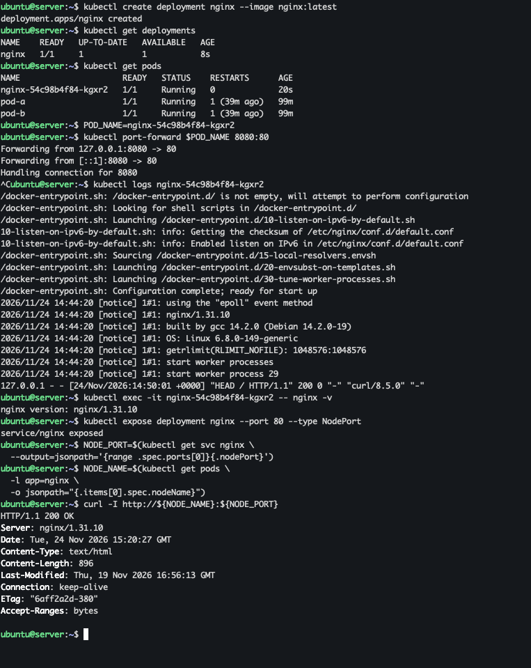

# 10. Smoke test

This stage checks that the cluster works end to end by deploying nginx, reaching it through `kubectl port-forward`, and exposing it through a NodePort service. It follows the tutorial's "Smoke Test" page, with the changes listed below.

## Differences from the tutorial

- **Where port-forward runs:** The tutorial runs `kubectl port-forward` on the jumpbox. In this run it ran on `server`, so `curl` was run there too. Both are valid, since `server` also has the kubeconfig.
- **etcd check:** The tutorial's `etcdctl` command needs the TLS flags in this lab. See stage 05 for the `ETCDCTL_*` variables and the `sudo -E` requirement.
- **Node names:** `kubectl exec`, `kubectl logs`, and `kubectl port-forward` all connect to the kubelet by node name, so `node-0` and `node-1` must resolve on `server` (see stage 09).

## 1. Deploy nginx

```bash
kubectl create deployment nginx --image nginx:latest
kubectl get deployments
kubectl get pods
```

Expected: `nginx` shows `1/1` ready, and its pod shows `Running`.

Set the pod name for the next steps:

```bash
POD_NAME=$(kubectl get pods -l app=nginx -o jsonpath="{.items[0].metadata.name}")
echo $POD_NAME
```

## 2. Check the pod logs

```bash
kubectl logs $POD_NAME
```

Expected: nginx startup messages, ending with `start worker processes`. Requests appear as log lines once they arrive.

## 3. Check the nginx version

```bash
kubectl exec -it $POD_NAME -- nginx -v
```

Expected: `nginx version: nginx/1.31.10`.

## 4. Port forwarding

Run the forward in one terminal:

```bash
kubectl port-forward $POD_NAME 8080:80
```

Expected output:

```
Forwarding from 127.0.0.1:8080 -> 80
Forwarding from [::1]:8080 -> 80
```

In a second session on the same machine as the forward (`server` in this run), request the page:

```bash
curl --head http://127.0.0.1:8080
```

Expected: `HTTP/1.1 200 OK` with nginx headers. The forward's terminal prints `Handling connection for 8080`, and the nginx log shows the `HEAD /` request.

Stop the forward with Ctrl+C.

## 5. Expose nginx with a NodePort service

```bash
kubectl expose deployment nginx --port 80 --type NodePort
NODE_PORT=$(kubectl get svc nginx --output=jsonpath='{range .spec.ports[0]}{.nodePort}')
NODE_NAME=$(kubectl get pods -l app=nginx -o jsonpath="{.items[0].spec.nodeName}")
echo "port=$NODE_PORT node=$NODE_NAME"
```

Request the service through the node the pod runs on:

```bash
curl -I http://${NODE_NAME}:${NODE_PORT}
```

Expected: `HTTP/1.1 200 OK`.

To check the other worker, run this from the jumpbox, substituting the NodePort printed above:

```bash
curl -I http://192.168.122.12:<NODE_PORT>
curl -I http://192.168.122.13:<NODE_PORT>
```

Expected: both return `HTTP/1.1 200 OK`, because `kube-proxy` on each worker forwards NodePort traffic to any pod.

_Pending: this check has not been run yet._

If a worker doesn't answer, check `kube-proxy` on that worker:

```bash
ssh ubuntu@node-0 "systemctl is-active kube-proxy; sudo iptables -t nat -L KUBE-NODEPORTS -n | head"
```




## Cleanup

Remove the test resources after recording the results:

```bash
kubectl delete svc nginx
kubectl delete deployment nginx
kubectl delete pod pod-a pod-b
```

`pod-a` and `pod-b` are the pod networking test pods from stage 09. They were still running when this test started, so they were deleted here.

## Issues encountered

**`etcdctl` failed with `error reading server preface: EOF`.** The tutorial's command doesn't pass TLS flags, and etcd in this lab accepts only TLS. Set the `ETCDCTL_*` variables and run with `sudo -E`.

**`etcdctl` failed with `permission denied` on the key.** The key in `/etc/etcd/` is owned by root. Run `etcdctl` with `sudo -E`.

**`curl` on the jumpbox couldn't connect to `127.0.0.1:8080`.** The port-forward was running on `server`, and `127.0.0.1` on the jumpbox is a different machine. Run the forward and the `curl` on the same machine.

**`kubectl create secret` returned `already exists`.** The secret from an earlier test was still present. This is harmless, since the existing secret is what the encryption check reads.

## Verified

- [x] nginx deployment `1/1` ready, pod `Running`
- [x] `kubectl logs` shows nginx startup and `HEAD /` requests
- [x] `kubectl exec ... nginx -v` reports `nginx/1.31.10`
- [x] `kubectl port-forward` forwards to the pod, and `curl` returns `HTTP/1.1 200 OK`
- [x] NodePort service exposed, and `curl` through the pod's node returns `HTTP/1.1 200 OK`
- [ ] NodePort checked through the other worker
